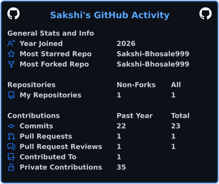

<h3 align="center">⚡ DEVELOPER • TECH ENTHUSIAST • PROBLEM SOLVER ⚡</h3>

  

---

### `1 WHO AM I?`

Hey there! I'm **Sakshi**, an IT student passionate about technology, development and solving real-world problems.

- 🔭 Exploring software development and emerging technologies
- 💻 Learning and building with different programming languages
- 🛡️ Interested in cybersecurity and AI
- 🧠 Constantly improving my problem-solving skills
- 🚀 Believer in learning by building

### `2 TECH ARSENAL`

**Languages**

**Tools & Technologies**

### `3 GITHUB STATISTICS`

  

### `4 CONNECT WITH ME`

  
  <!-- Add your LinkedIn and other social links here -->

---

  <i>"The future belongs to those who build it."</i>
   
  <b>⚡ SYSTEM STATUS: ALWAYS LEARNING ⚡</b>

