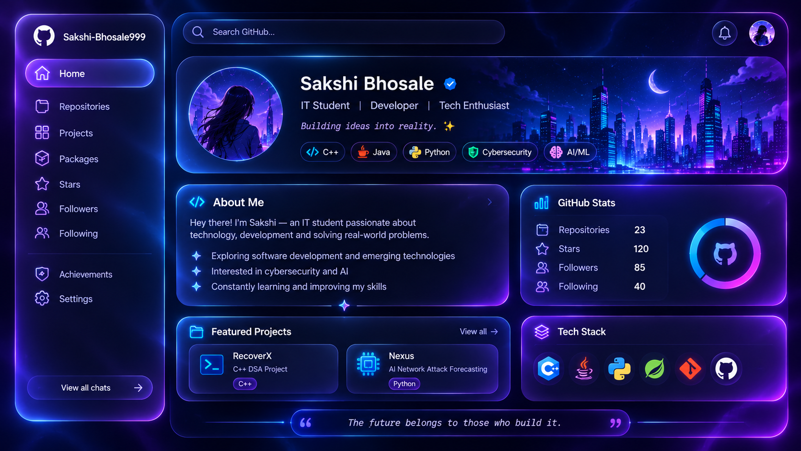

  

   

  <h1>✦ SAKSHI BHOSALE ✦</h1>

  <h3>IT Student&nbsp; | &nbsp;Developer&nbsp; | &nbsp;Tech Enthusiast</h3>

  
<i>Building ideas into reality. ✨</i>

  
  
  
  
  

 

<table>
<tr>
<td width="55%" valign="top">

## 💠 About Me

Hey there! I'm **Sakshi**, an IT student passionate about technology, development and solving real-world problems.

- ✦ Exploring software development and emerging technologies
- ✦ Interested in cybersecurity and AI
- ✦ Constantly learning and improving my skills
- ✦ Turning creative ideas into practical projects

</td>
<td width="45%" valign="top">

## 📊 GitHub Statistics

  

  

## 🚀 Featured Projects

### 🔹 RecoverX
C++ DSA Project

[View Repository](https://github.com/Sakshi-Bhosale999)

### 🔹 Nexus
AI Network Attack Forecasting

[View Repository](https://github.com/Sakshi-Bhosale999)

</td>
<td width="45%" valign="top">

## 🛠️ Tech Stack

</td>
</tr>
</table>

## 🔥 Contribution Activity

  

## 🌐 Connect With Me

 

  <h3>✦ The future belongs to those who build it. ✦</h3>

  

